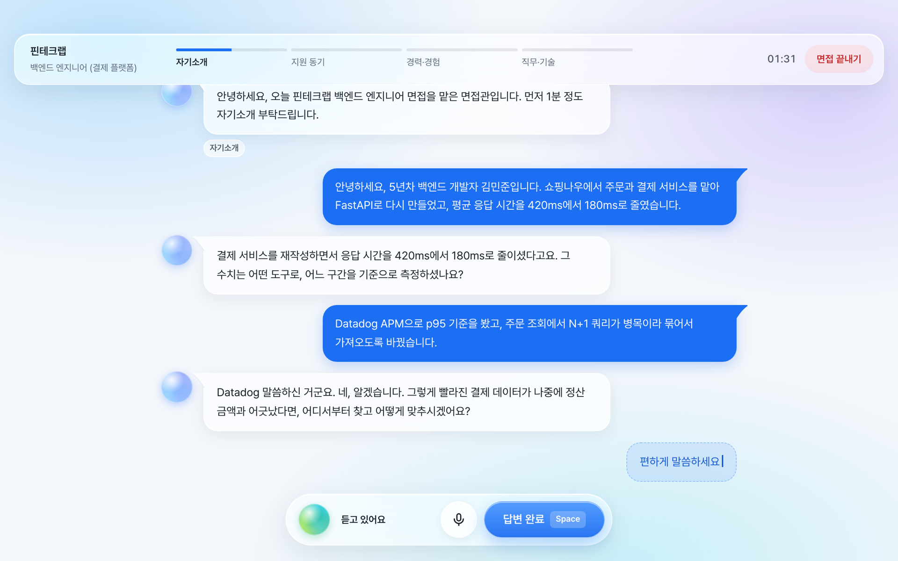
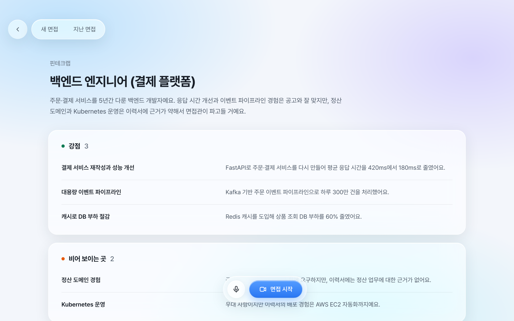
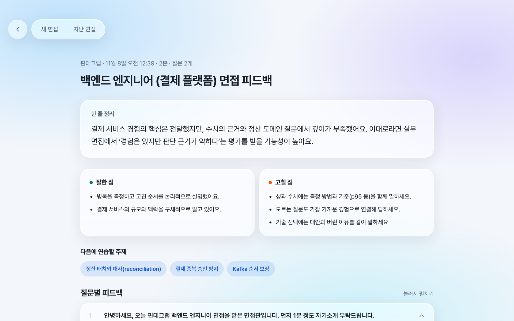
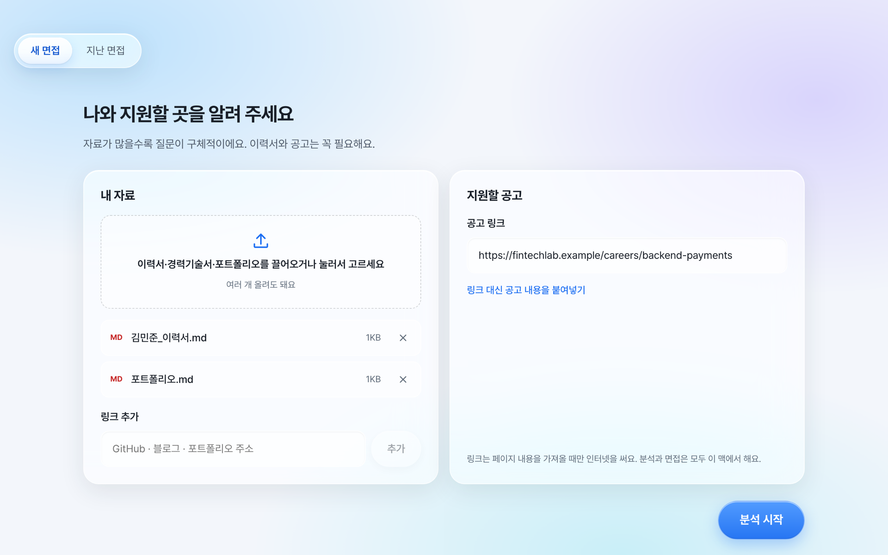
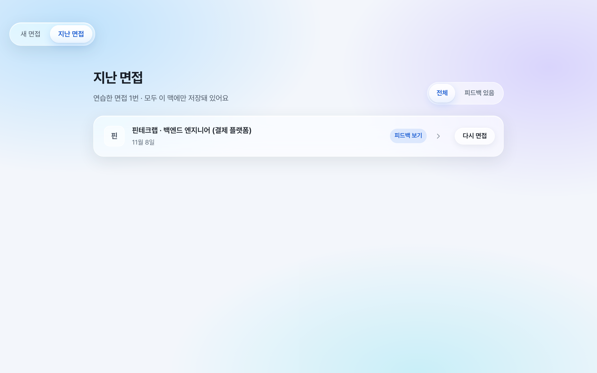
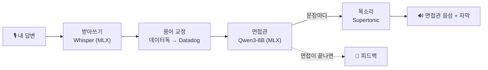

<p align="center">
  
</p>

<h1 align="center">Socrates</h1>

<p align="center">
  <b>내 맥 안에서만 돌아가는 AI 모의 면접관</b><br>
  이력서를 읽고, 목소리로 묻고, 애매한 답은 끝까지 파고듭니다.
</p>

<p align="center">
  <a href="https://github.com/onlybyjack/socrates/releases/latest"></a>
  <a href="https://github.com/onlybyjack/socrates/releases"></a>
  
  
  <a href="LICENSE"></a>
</p>

<p align="center">
  <a href="https://github.com/onlybyjack/socrates/releases/latest">
    
  </a>
</p>

<p align="center">
  
</p>

---

혼자 면접을 준비할 때 정말 필요한 건 예상 질문 목록이 아니라, **내 이력서를 읽고 내 답을 들은 다음 "그 수치는 어떻게 쟀어요?"라고 되묻는 사람**입니다.

Socrates가 그 역할을 합니다. 이력서와 공고를 넣으면 파고들 지점을 먼저 찾고, 면접관이 목소리로 질문하고, 내 답이 모호하면 꼬리 질문으로 끝까지 따라옵니다. 면접이 끝나면 듣기 좋은 말 대신 실제 채용 회의에서 나올 법한 피드백을 줍니다.

그리고 이 모든 게 **인터넷 없이 내 맥 안에서** 일어납니다. 계정도, 구독도, API 키도 없습니다. 이력서와 답변 음성은 어디로도 나가지 않습니다.

## ✨ 주요 기능

<table>
  <tr>
    <td width="50%" valign="top">
      <h3>🎯 이력서 × 공고 분석</h3>
      공고가 원하는 사람과 내 경험을 맞춰 보고 <b>강점</b>, <b>비어 보이는 곳</b>, <b>파고들 지점</b>을 정리합니다. 면접관은 이 지점을 노립니다.
      <br><br>
      
    </td>
    <td width="50%" valign="top">
      <h3>📝 아첨 없는 피드백</h3>
      질문마다 잘한 점, 아쉬운 점, 내 이력서의 경험을 짚은 <b>"이렇게 답해 보세요"</b>를 줍니다. 근거가 없으면 잘한 점도 비워 둡니다.
      <br><br>
      
    </td>
  </tr>
  <tr>
    <td width="50%" valign="top">
      <h3>📂 자료는 넣기만</h3>
      이력서·경력기술서·포트폴리오(PDF, TXT, MD)와 GitHub·블로그 링크, 공고 링크만 있으면 됩니다.
      <br><br>
      
    </td>
    <td width="50%" valign="top">
      <h3>🔁 같은 공고로 다시</h3>
      지난 면접에서 분석 없이 바로 다시 연습합니다. 피드백을 만드는 중인 면접은 진행 상태가 보입니다.
      <br><br>
      
    </td>
  </tr>
</table>

그 밖에도:

- 🎙 **진짜 대화처럼:** 면접관 자막이 목소리에 맞춰 흐르고, 말을 멈추면 알아서 답이 넘어갑니다. 채팅으로 답해도 됩니다.
- 🔎 **꼬리 질문:** 자기소개 → 지원 동기 → 경력·경험 → 직무·기술 순서로, 질문마다 최대 두 번 더 파고듭니다.
- 🧠 **용어를 알아듣는 면접관:** 받아쓰기가 "데이터독"이라고 적어도 Datadog으로 알아듣고, "Datadog 말씀하신 거군요."라고 짚고 넘어갑니다. 내 자료와 채용 공고에 나온 이름만 되살리기 때문에 개발자든 디자이너(Figma)든 마케터(GA4)든 똑같이 동작하고, 없는 이름을 지어내지 않습니다.
- 🗣 **매번 다른 면접관:** 세션마다 남성·여성 면접관 목소리가 무작위로 정해집니다.

## 🤔 왜 Socrates인가요?

|  | **Socrates** | 클라우드 AI 챗봇으로 연습 | 스터디 모의 면접 |
|---|:---:|:---:|:---:|
| 내 이력서 기반 질문 | ✅ 자동 분석 | △ 매번 붙여넣기 | ✅ |
| 목소리로 주고받기 | ✅ | △ | ✅ |
| 근거를 캐묻는 꼬리 질문 | ✅ | △ 프롬프트에 따라 | 사람에 따라 |
| 이력서·답변이 밖으로 | **안 나감** | 서버로 전송 | 공유 필요 |
| 비용 | **무료** | 구독 | 시간 |
| 새벽 2시에도 | ✅ | ✅ | ❌ |

## 📦 설치

> **필요한 것:** Apple Silicon 맥(M1 이상) · macOS 13 이상 · 메모리 16GB 이상 권장 · 디스크 여유 약 8GB

1. [**Releases**](https://github.com/onlybyjack/socrates/releases/latest)에서 `Socrates_x.y.z_aarch64.dmg`를 받습니다.
2. `.dmg`를 열고 Socrates를 응용 프로그램 폴더로 옮깁니다.
3. 처음 열 때 "확인되지 않은 개발자" 경고가 뜨면 **오른쪽 클릭 → 열기**로 엽니다.
4. 첫 실행 화면에서 필요한 모델(약 6.6GB)을 알아서 받습니다. 다음부터는 몇 초면 켜집니다.

다른 프로그램은 설치할 필요가 없습니다. 앱 하나에 다 들어 있습니다.

<details>
<summary>경고가 계속 떠서 열리지 않으면</summary>

아직 Apple 공증을 받지 않은 앱이라 생기는 경고입니다. 터미널에서 한 번 실행하세요.

```bash
xattr -dr com.apple.quarantine /Applications/Socrates.app
```
</details>

## 🚀 사용법

1. **마이크 확인:** 권한을 허용하고 문장을 읽어 소리가 들어오는지 봅니다. 마이크 없이 채팅으로 해도 됩니다.
2. **자료 넣기:** 이력서·포트폴리오와 링크, 지원할 공고를 넣고 **분석 시작**.
3. **면접 준비:** 분석을 훑어보고 **면접 시작**.
4. **면접:** 소리 내어 답합니다. 바로 넘기려면 <kbd>Space</kbd>, 언제든 **면접 끝내기**.
5. **피드백:** 끝나면 피드백이 만들어집니다. 다른 화면에 가 있어도 계속 만듭니다.

> 💡 조용한 곳에서, 실제 면접처럼 소리 내어 답할 때 가장 효과가 좋습니다.

## ⚙️ 작동 방식

모든 모델이 앱 안의 로컬 백엔드에서 Apple Silicon GPU로 돌아갑니다. 별도 서버나 실행기를 띄우지 않습니다.



- 정해진 질문 목록을 읽지 않습니다. 분석에서 뽑은 주제를 바탕으로 매번 내 답에 맞춰 다음 말을 새로 만듭니다.
- 면접관은 답을 듣고 꼬리 질문을 할지 다음 주제로 갈지 스스로 정하고, 말을 만드는 대로 문장 단위로 바로 들려줍니다.
- M 시리즈 맥 기준, 답이 끝난 뒤 면접관의 첫 음성까지 보통 2~4초 걸립니다.

| 구성 | 사용 기술 |
|---|---|
| 앱 | Tauri 2 · React 19 · TypeScript |
| 백엔드 | Python · FastAPI · SQLite |
| LLM | Qwen3-8B 4bit on [MLX](https://github.com/ml-explore/mlx) |
| 받아쓰기 | whisper-large-v3-turbo on mlx-whisper · Silero VAD |
| 목소리 | Supertonic 3 (ONNX) |

## 🔒 개인정보

- 이력서, 공고, 답변 음성, 대화 기록, 피드백은 **모두 내 맥에만** 저장됩니다: `~/Library/Application Support/interview-agent/`
- 인터넷은 내가 넣은 링크를 가져올 때와 모델을 처음 내려받을 때만 씁니다.
- 분석, 받아쓰기, 질문 생성, 목소리, 피드백은 모두 이 맥에서 처리됩니다.

## ❓ 자주 묻는 질문

<details>
<summary><b>정말 인터넷 없이 되나요?</b></summary>

네. 처음 실행할 때 모델을 한 번 받고 나면 인터넷 없이 동작합니다. 공고를 링크로 넣으면 그 페이지를 가져올 때만 인터넷을 쓰고, 공고 본문을 직접 붙여넣으면 그마저도 필요 없습니다.
</details>

<details>
<summary><b>Intel 맥이나 Windows에서도 되나요?</b></summary>

아직 안 됩니다. LLM과 받아쓰기가 Apple Silicon 전용(MLX)이라 M1 이상 맥이 필요합니다.
</details>

<details>
<summary><b>메모리 8GB 맥에서도 되나요?</b></summary>

8B 모델과 받아쓰기 모델을 함께 올리기 때문에 16GB 이상을 권장합니다. 8GB에서는 느리거나 멈출 수 있습니다.
</details>

<details>
<summary><b>영어 면접도 되나요?</b></summary>

지금은 한국어 면접만 지원합니다. 다른 언어 지원은 로드맵에 있습니다.
</details>

<details>
<summary><b>기록은 어떻게 지우나요?</b></summary>

앱을 끄고 `~/Library/Application Support/interview-agent/` 폴더를 지우면 됩니다. 받아 둔 모델은 남아 있어서 다시 받지 않습니다.
</details>

## 🛠 소스에서 빌드하기

<details>
<summary>개발 환경 설정, 빌드, 테스트</summary>

**필요한 것:** Python 3.12+와 [uv](https://docs.astral.sh/uv/), Node 20+와 pnpm, Rust(rustup)

```bash
# 터미널 1: 백엔드 (127.0.0.1:8765)
cd backend
uv sync
uv run python -m interview_agent

# 터미널 2: 앱
cd app
pnpm install
pnpm tauri dev
```

- 개발 모드에서는 앱이 백엔드를 켜지 않으니 두 터미널을 함께 띄웁니다.
- 화면 코드(`app/src`)는 저장하면 바로 반영되고, 백엔드는 바꾼 뒤 다시 켜야 합니다.
- 모델은 앱의 첫 실행 화면이 받습니다. 백엔드만 쓸 때는 미리 받아 두세요.
  `uv run python -c "from huggingface_hub import snapshot_download; snapshot_download('mlx-community/Qwen3-8B-4bit')"`
- Homebrew rustup이면 `export PATH="/opt/homebrew/opt/rustup/bin:$PATH"`가 필요할 수 있습니다.

**배포용 .dmg**

```bash
./scripts/build-dmg.sh   # → app/src-tauri/target/release/bundle/dmg/
```

**테스트**

```bash
cd backend && uv run pytest
cd app && pnpm build
```

**설정 (환경 변수)**

| 변수 | 기본값 |
|---|---|
| `IA_LLM_MODEL` | `mlx-community/Qwen3-8B-4bit` |
| `IA_STT_MODEL` | `mlx-community/whisper-large-v3-turbo` |
| `IA_TTS_VOICES` | `M3,F2` (세션마다 무작위) |
| `IA_DATA_DIR` | `~/Library/Application Support/interview-agent` |
| `IA_PORT` | `8765` |

**프로젝트 구조**

```
app/        Tauri 앱 (React · TypeScript), src-tauri/ 는 Rust 셸
backend/    FastAPI 백엔드, tests/, packaging/ (PyInstaller)
scripts/    .dmg 빌드 스크립트
```
</details>

## 🗺 로드맵

- [ ] 면접 길이 선택 (짧게 · 보통 · 길게)
- [ ] 직무별 면접 흐름 (프론트엔드, 데이터, 디자인, PM)
- [ ] 더 큰 모델 선택 (Qwen3-14B 등)
- [ ] 피드백 생성 중에도 면접 질문 먼저 처리
- [ ] 영어 면접
- [ ] Apple 공증

## 🤝 기여하기

이슈와 PR 모두 환영합니다. 특히 이런 도움이 필요합니다.

- 더 날카로운 꼬리 질문을 위한 프롬프트 개선, 작은 모델 튜닝
- 직무별 면접 흐름과 평가 기준
- 다른 언어 지원

PR 전에 `cd backend && uv run pytest`와 `cd app && pnpm build`가 통과하는지 확인해 주세요.

## 🙏 감사의 말

Socrates는 이 오픈소스 프로젝트들 위에 만들어졌습니다.

[Qwen3](https://github.com/QwenLM/Qwen3) · [MLX](https://github.com/ml-explore/mlx) · [mlx-lm](https://github.com/ml-explore/mlx-lm) · [Whisper](https://github.com/openai/whisper) · [mlx-whisper](https://github.com/ml-explore/mlx-examples) · [Supertonic](https://huggingface.co/Supertone/supertonic-3) · [Silero VAD](https://github.com/snakers4/silero-vad) · [vad-web](https://github.com/ricky0123/vad) · [Tauri](https://tauri.app) · [FastAPI](https://fastapi.tiangolo.com) · [Pretendard](https://github.com/orioncactus/pretendard)

Supertonic 모델은 OpenRAIL-M 라이선스의 사용 제한(사칭 등 악용 금지)을 따릅니다. Qwen3는 Apache 2.0, Whisper·Silero VAD·MLX는 MIT 라이선스입니다.

## ⭐ Star History

<a href="https://star-history.com/#onlybyjack/socrates&Date">
  
</a>

## 📄 라이선스

[MIT](LICENSE) © Junseok Kim

<p align="center"><sub>스크린샷 속 지원자(김민준)와 회사(핀테크랩)는 모두 가상입니다.</sub></p>
